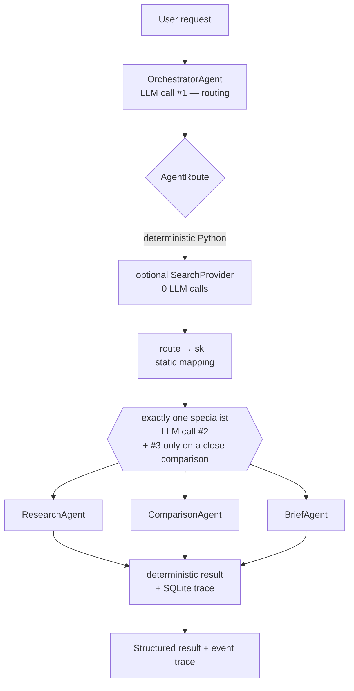

# DecisionForge

A constrained, cost-conscious multi-agent application. You ask a
decision-oriented question; one **orchestrator** classifies it and routes it to
**exactly one** of three specialist agents, which returns a structured answer.
Everything else — the search tool, skill selection, formatting, persistence, the
web UI — is deterministic Python.

Live-demo ready: a FastAPI + vanilla-JS frontend that shows the route, the
specialist, whether search ran, the structured result, and the full execution
trace, deployable on Vercel.



## Overview

DecisionForge answers three kinds of software-decision question:

| Ask | Route | Specialist |
|---|---|---|
| investigate / explain a topic | `research` | **Research Agent** |
| compare options, weigh tradeoffs, recommend one | `comparison` | **Comparison Agent** |
| turn supplied material into an executive brief | `brief` | **Brief Agent** |

The orchestrator makes the routing decision semantically (one LLM call). A
static `route → skill` table and a static `SEARCH_ENABLED_ROUTES` set do the
rest — no second model call to pick a skill or decide whether to search.

## Why this architecture

- **A single generic prompt** handles these requests unpredictably and can't
  specialize.
- **A full agent swarm** (planner, judge, loops, fan-out) is expensive, slow,
  and hard to reason about. An earlier version of this project was exactly that;
  it was deliberately removed (see `docs/architecture.md` → *Architecture
  Reframe*).
- **This design** is the small middle: controlled hierarchical delegation — one
  parent, one child per request — with a hard ceiling on cost.

## Architecture

```
User
 → OrchestratorAgent        semantic routing            (LLM call #1)
 → AgentRoute
 → deterministic Python      dispatch, no second routing step
 → optional SearchProvider   research / comparison only  (0 LLM calls)
 → route → skill (static)    SKILL.md body → specialist prompt
 → exactly one specialist    the work                    (LLM call #2, +#3 on a close comparison)
 → deterministic Python      format, persist, trace
 → structured result + event trace
```

**Hard rules** (enforced by tests): max **3 LLM calls** per request (the third
only when a comparison is a close call) and a $0.002 per-run budget; **no**
retries, loops, fallback agents, or parallel LLM calls; specialists never call
other agents; the LLM only does semantic work.

Full detail and the deployment topology: **`docs/architecture.md`**.

## Agents

Exactly four logical agents:

- **OrchestratorAgent** — classifies the request into one `AgentRoute`. One
  structured model call; returns a `RoutingDecision` (route + short reasoning).
  Does not answer, research, or invoke a specialist.
- **ResearchAgent**: investigates any topic ("Research agentic AI workflows").
  In grounded mode (the default in the app), every finding cites a numbered
  search result and quotes it, and code verifies each quote before the finding
  is shown (see *Grounded research* below).
- **ComparisonAgent**: compares alternatives. With the decision engine on (the
  default in the app), it does not write a verdict. It extracts a decision model
  that deterministic code scores and simulates (see *Decision engine* below), and
  the options, recommendation, confidence and tradeoffs are generated from those
  numbers.
- **BriefAgent** — transforms user-supplied context into a titled executive
  brief with key points and action items. Requires context; performs no
  research.

Each specialist is a leaf: one model call, no delegation.

## Decision engine

An LLM is good at reading a messy question and knowing what matters; it is bad
at consistent arithmetic and honest confidence numbers. So the comparison route
splits the work (neuro-symbolic):

1. **LLM, one call:** extract a `DecisionModel`: 2-4 options, the criteria that
   matter for *this* decision with weights, and a **low-high score range** (0-10)
   for every option and criterion, each citing the search result that supports
   it, or `null` for general knowledge (`app/models/decision.py`).
2. **NumPy, $0** (`app/decision/engine.py`):
   - **Weighted score** for each option, using range midpoints.
   - **Monte Carlo simulation**: 4,000 draws with weights from a Dirichlet
     around the stated weights and scores uniform within their ranges. The share
     of wins is each option's **win probability**, and the verdict is *robust*
     (≥ 80%), *leaning* (≥ 60%) or *toss-up*.
   - **Flip points**: for each criterion, the exact weight at which a different
     option would win. Scores are linear in that weight, so the crossing is
     solved in closed form rather than searched for.
3. **Deterministic prose** (`app/decision/summary.py`): recommendation =
   simulation winner, confidence = its win probability, tradeoffs = flip points.
   The text cannot disagree with the math.

Example output: *"PostgreSQL: a robust winner (wins 83% of simulations). If
Schema flexibility carried 24% of the weight (now 20%), MongoDB would win."*

The UI shows win-probability bars, criteria weights, the score-range table with
citations, and the flip points. Set `DECISION_ENGINE=false` to restore the
free-text comparison specialist.

### Adaptive uncertainty

Spending more compute only where it changes the answer:

- If the first analysis is **robust** (win probability ≥ 80%), the run stops
  there: 2 LLM calls in total.
- If it is **leaning or a toss-up**, the agent takes **one** more, independently
  framed extraction ("score it from scratch as a skeptical reviewer"). The two
  samples are merged (`app/decision/ensemble.py`): shared scores take the
  envelope of both ranges and weights are averaged. The merged model is then
  re-simulated, so the samples' disagreement shows up as lower confidence
  instead of being averaged away. The report records `samples: 2` and the
  measured disagreement.
- A failed second call (budget, bad JSON) falls back to the first answer.
  `ADAPTIVE_SAMPLES=false` turns this off.

Offline estimate: about $0.0004 for a clear comparison and $0.0007 for a close
one (3 calls), both under the $0.002 per-run budget.

## Grounded research

Research agents commonly fail by citing sources that do not say what is
claimed, or that do not exist. DecisionForge makes every citation checkable:

1. The search tool's results are numbered (`Result 1..n`) and passed to the
   agent both as text and as structured evidence.
2. **LLM, one call:** a summary plus 3-6 findings, each with `source` = the
   result it relies on and `quote` = 5-20 words copied from that result, or
   `source: null` for general knowledge. The model never writes URLs.
3. **Verifier, $0** (`app/grounding/verify.py`): each quote is checked against
   the cited result's title and snippet, verbatim after normalisation or
   near-verbatim (80% of words present). Citations to results that were never
   shown, quotes under three words, and quotes the result does not contain are
   **rejected**, with a reason.
4. Verified findings keep their `[n]` link, uncited ones are labelled *general
   knowledge*, and rejected ones move to limitations. `sources` is derived
   from verified citations, so an invented URL cannot reach the answer.

The comparison engine's score citations get the same treatment: a citation to
a result number that was never shown is removed and counted.

This proves *provenance* (the model really read this in result n), not
*entailment* (the quote fully supports the claim). Checking entailment would
need an LLM judge, which is a deliberate cost/benefit choice for later.

For real research, turn on live search (free, no API key):
`pip install -e ".[search]"` and `SEARCH_PROVIDER=duckduckgo`.
`GROUNDED_RESEARCH=false` restores free-text findings.

## Agent Skills

`skills/{research,comparison,executive-brief}/` — each a `SKILL.md` (YAML
frontmatter + Markdown body) with optional `references/` and `scripts/`. Loaded
with **three-stage progressive disclosure**:

1. **Discovery** — metadata (name, description) only.
2. **Activation** — the SKILL.md body, injected into the selected specialist's
   system prompt.
3. **Extension** — references / scripts, only on explicit request.

The route determines the skill (`app/skills/mapping.py`) — deterministic, no LLM.

## Deterministic tools

`SearchProvider` gathers external evidence **before** the specialist call:

- `MockSearchProvider` / `DemoSearchProvider` — offline, deterministic (the
  default).
- `DuckDuckGoSearchProvider` — optional, no API key (`pip install -e ".[search]"`,
  `SEARCH_PROVIDER=duckduckgo`).

Research and Comparison are search-eligible; **Brief never searches**. Evidence is
rendered to plain text with deterministic size caps (≤5 results, ≤500 chars each,
~2500 total) before it reaches the model. Search adds **zero** LLM calls; a
search failure stops the request with no retry and no fallback.

## Cost-conscious design

| Lever | Value |
|---|---|
| LLM calls per successful request | **2** (1 routing + 1 specialist) |
| Default model | `claude-haiku-5-5` ($0.10 / $0.50 per million tokens in / out) |
| Effort / thinking | `low` / disabled, so no hidden thinking tokens are billed |
| Output cap per call | 800 tokens; the JSON schema is sent minified |
| Per-run budget | **$0.002** and 3 calls (`RUN_BUDGET_USD`, `RUN_MAX_LLM_CALLS`) |
| Lifetime spend cap | **$0.03** across all runs (`SPEND_LIMIT_USD`, kept in `data/spend.json`) |
| Typical run | about **$0.0003** (shown in the UI and the trace) |
| Retries / fallback agents / parallel calls | 0 / 0 / 0 |

**Metering.** Every model call is recorded in a per-run `UsageLedger`
(`app/providers/usage.py`) and appears in the trace as an `llm.call` event with
token counts and dollars. Before a live call is sent, its *worst case* (estimated
input plus the full `max_tokens`) is checked against the run budget and the
lifetime cap; if either could be exceeded, `BudgetExceededError` is raised and
nothing is sent. Offline runs show what the same calls would cost live.

**Record/replay** (`app/providers/replay.py`). With `REPLAY_MODE=auto`, each
distinct prompt is paid for once and stored in a cassette
(`cassettes/default.json`); `REPLAY_MODE=replay` then serves those real outputs
with no key and no cost, for tests, CI, and the hosted demo.

```bash
python scripts/cost_demo.py "Compare PostgreSQL and MongoDB"   # per-call cost table, offline
```

This is not autonomous multi-step reasoning: there are no loops and no
self-critique, and the model never decides to use a tool.

## Tech stack

- **Python 3.12**, `pydantic` v2 for every typed contract.
- **FastAPI** + vanilla HTML/CSS/JS (no framework, no build step).
- Standard-library `sqlite3` for run + event persistence.
- `pyyaml` for SKILL.md frontmatter.
- Optional: `anthropic` (real model calls), `ddgs` (real web search),
  `uvicorn` (local server).
- No LangChain / LlamaIndex / agent framework — the orchestration layer is ~100
  lines of deterministic Python.

## Local development

```bash
python -m venv .venv
source .venv/bin/activate
pip install -e ".[dev]"          # pydantic, pyyaml, fastapi, pytest, httpx
```

Run the web UI (offline, zero cost):

```bash
pip install -e ".[dev,web]"      # adds uvicorn
python scripts/web_demo.py       # http://127.0.0.1:8000
```

Zero-cost CLI demos:

```bash
python scripts/dispatch_demo.py      # end-to-end: request → orchestrator → [search] → one specialist
python scripts/eval_demo.py          # routing accuracy + specialist contract checks
python scripts/skills_demo.py        # progressive disclosure
python scripts/tools_demo.py         # search tool + context builder
python scripts/persistence_demo.py   # one run persisted to a temp SQLite DB + its events
python scripts/cost_demo.py          # tokens and dollars per model call
```

Real Claude / real search are opt-in and billable — see `docs/architecture.md`
and the `--live` / `--real-search` flags in the demo scripts. **Do not run
`--live` unless you intend to spend API credit.**

## Vercel deployment

DecisionForge deploys as a single Python serverless function (`api/index.py`) —
no database, no second service.

1. **Push this repo to GitHub.**
2. **Import it into Vercel** (New Project → import). Vercel detects Python from
   `api/index.py` and installs `requirements.txt`. If Project Settings shows an
   old Python version, set it to **3.12** and redeploy.
3. **Set Environment Variables:**

   *Offline demo* — no credentials, no cost:
   ```
   MODEL_PROVIDER=mock
   PERSISTENCE_ENABLED=false
   ```
   *Real Claude demo* — **uses the Anthropic API, may incur charges** (`anthropic`
   is already in `requirements.txt`):
   ```
   MODEL_PROVIDER=anthropic
   ANTHROPIC_API_KEY=<your key>
   ANTHROPIC_MODEL=claude-haiku-5-5      # the default if unset
   RUN_BUDGET_USD=0.002                  # hard per-request ceiling
   SPEND_LIMIT_USD=0.03                  # lifetime cap (per instance; Vercel's disk is ephemeral)
   PERSISTENCE_ENABLED=false
   ```
4. **Deploy** (auto-deploys on every push).
5. **Verify:** open `/` (the UI), then `GET /api/health` →
   `{"status":"ok","model_provider":"mock|anthropic","persistence_enabled":false,...}`.

The deployment is **stateless** — Vercel's filesystem is ephemeral, so
`GET /api/runs` returns `[]` and each `POST /api/runs` response carries the full
result + trace. Durable history is a local feature (`PERSISTENCE_ENABLED=true`).
A request is at most 3 LLM calls (2 unless a comparison is a close call) in every mode.

## Demo

For the 10-minute live demo:

- **`docs/demo-guide.md`** — a minute-by-minute run sheet (no slides).
- **`docs/demo-scenarios.md`** — the three scenarios with exact inputs, expected
  route/skill/search behavior, and the code files to open.

Recommended primary scenario: **Comparison** — it exercises routing, specialist
selection, the search tool, an Agent Skill, structured output, a recommendation
with a simulated win probability, and the call ceiling in one request.

## Evaluation

`evals/golden_set.json` holds 36 hand-written cases (18 comparison, 10 research,
8 brief), including deliberately ambiguous wording ("Help me decide between…",
"Summarize what zero-trust means…"). `scripts/run_eval.py` runs every case end to
end through the real pipeline and scores it with deterministic metrics, with no
LLM judge:

| metric | measures |
|---|---|
| `route_accuracy` | routed to the expected specialist |
| `contract_pass` | result validates and meets its route's semantic minimums |
| `option_recall` | the expected options are actually compared |
| `recommendation_match` | the recommendation is acceptable (only where one is clear-cut) |
| `rubric_coverage` | rubric terms a complete answer should mention |
| `decision_completeness` | share of option x criterion cells the decision model scored |
| `groundedness` | share of research findings with a verified citation |
| `citation_precision` | share of cited findings whose quote really is in the cited result |

Each report (`evals/reports/<label>.md` + `.json`) includes the cost per case,
call counts, and p50 latency. `--baseline` adds a delta column for regression
tracking.

**Calibration** (`app/evaluation/calibration.py`): for the 13 comparisons with a
clear-cut answer, the winner's win probability is treated as a prediction.
Reports include the **Brier score**, the **expected calibration error** and a
reliability table, which answer the question: when DecisionForge says 80%, is it
right about 80% of the time? These are reported, not gated on, because a few
dozen cases make them noisy.

```bash
python scripts/run_eval.py                          # offline demo provider, $0
python scripts/run_eval.py --provider replay        # recorded real answers, $0
python scripts/run_eval.py --provider live --limit 5          # prints worst case and stops
python scripts/run_eval.py --provider live --limit 5 --yes-spend   # billable, recorded
```

The committed `evals/reports/demo.md` is the offline baseline. The demo provider
returns canned answers, so its quality scores are near zero by design. It
validates the harness, and its two misroutes show where a keyword router fails.

## Testing

```bash
pytest
```

~300 tests, all offline — the Anthropic SDK and any search backend are mocked;
SQLite uses temp files. Coverage includes the call ceiling per route, skill
isolation, search policy, stateless vs. persistent modes, the Vercel entrypoint's
import-safety, and a deterministic routing-evaluation harness
(`app/evaluation/`, `scripts/eval_demo.py`).

## Limitations

- **Not autonomous.** No multi-step reasoning, no loops, no self-critique, no
  model-driven tool use — by design.
- **The offline demo's model outputs are canned** (`DemoModelProvider`). Routing,
  search, skills, persistence and the trace are real; the answers are
  placeholders. Set `MODEL_PROVIDER=anthropic` for real answers.
- **Deployed history is stateless.** Durable run history needs local mode or a
  future `RunRepository` backed by a hosted database.
- **Live web search** is off by default; the DuckDuckGo provider is a snippet
  fetcher, not a crawler.
- **No authentication** — a deployed instance in `anthropic` mode will spend your
  API credit for anyone with the URL.
